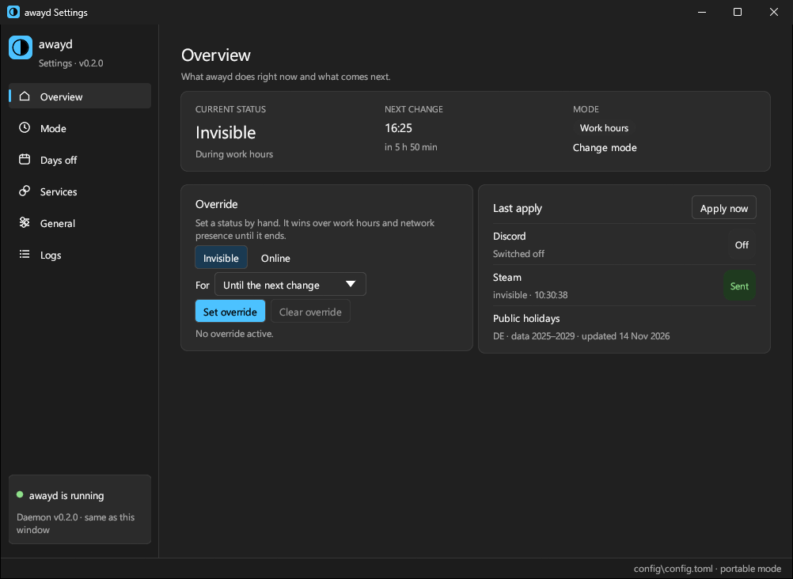
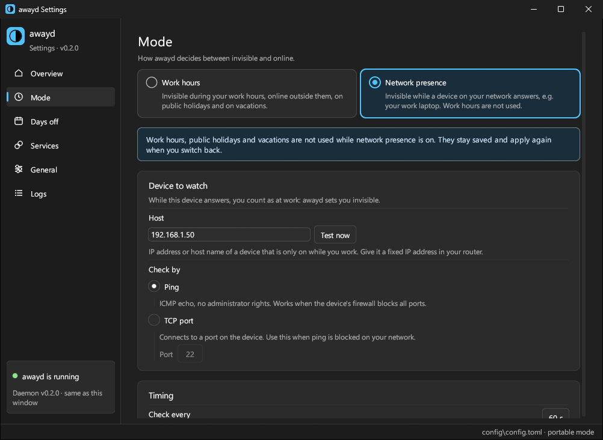
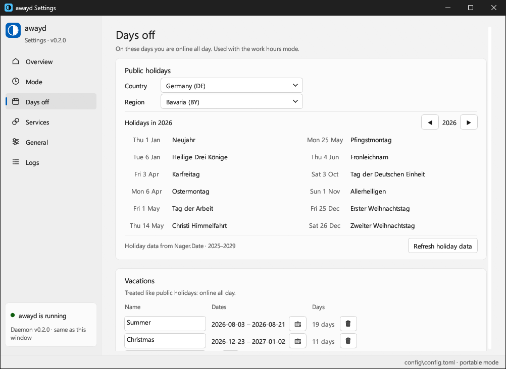
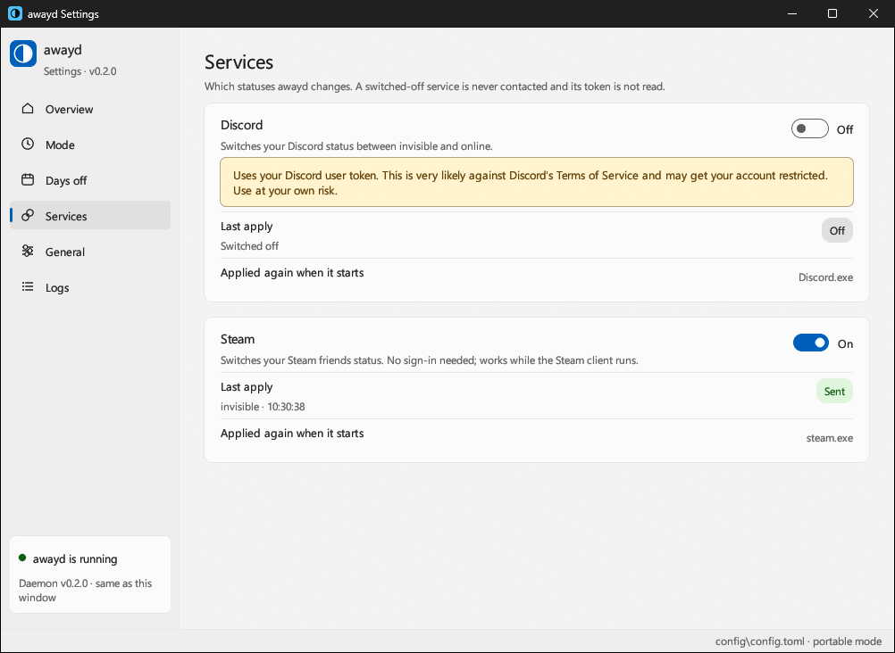
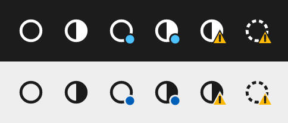

<p align="center"></p>

<h1 align="center">awayd</h1>

<p align="center">Invisible while you work, online when you are free: automatic <b>Steam</b> and
<b>Discord</b> status for Windows.</p>

<p align="center"></p>

awayd runs in the system tray and switches your status automatically: **invisible** during your
work hours, **online** outside of them. It knows public holidays, your vacations and manual
overrides ("stay invisible for 2 hours"). Instead of work hours it can also follow a device on
your network, e.g. your work laptop. It is built to run next to games: it uses about 20 MB of
memory and practically no CPU while idle.

> [!NOTE]
> The screenshots show the current development version (`main`). The latest release,
> v0.2.0, does not have the redesigned settings window and tray yet.

> [!WARNING]
> **Discord: use at your own risk.** awayd changes your Discord status through Discord's web API
> with **your user token** (the token of your normal Discord account) and a browser user agent.
> Automating a user account this way is very likely against Discord's Terms of Service
> ("self-bot") and may get your account restricted or banned. Discord is therefore **switched
> off** in a new installation; switch it on (Settings → Services) only if you accept
> that risk.

awayd is an independent project. It is **not affiliated with, endorsed by or sponsored by Valve
Corporation (Steam) or Discord Inc.** "Steam" and "Discord" are trademarks of their respective
owners and are used here only to describe what the program works with.

## Features

- **Two ways to decide:** work hours per weekday with public holidays (country and region) and
  vacations, or **network presence** (invisible while a device on your network answers)
- **Overview** of the current status, the next change and the last apply per service
- **Override** from the settings, the tray or the CLI: invisible or online for 30 minutes up to
  4 hours, or until the next scheduled change
- Choose the services awayd manages: Steam (on by default) and Discord (off by default)
- Re-applies the status when Steam or Discord starts and after resume from standby; Steam is
  only touched while it is running (awayd never starts Steam)
- Tray icon that shows the state by its shape, readable in light and dark taskbars
- Settings window in light or dark (or following Windows), live log view, command-line client
- Light on resources (see [below](#light-on-resources))
- Portable: everything lives next to the executables

## Screenshots

| Network presence | Days off | Services |
|---|---|---|
|  |  |  |

### Tray



From left: online · invisible · override (online) · override (invisible) · warning · status
unknown. **Left click** opens the settings, **right click** the menu: the status with its next
change, "Invisible ▸" and "Online ▸" for an override with a duration, "Clear override" while one
is active, "Apply now", "Open settings…", "Quit". A warning line (e.g. a missing Discord token)
opens the matching settings page.

## Light on resources

awayd stays resident next to games, so it is kept small. Measured on Windows 11 with about 450
running processes, awayd idle over 60 s:

| | |
|---|---|
| CPU | below the measurement resolution (≤ 16 ms per minute) |
| Memory | about 20 MB working set, 8 MB private |
| Threads | 9 |

- Program starts are noticed by comparing the list of process IDs (no WMI, no full process
  snapshot); the check runs every 5 s by default, can be set to 2–60 s or off
  (**Settings → General → Advanced**) and rests completely when no switched-on service has a
  program to watch.
- Between status changes awayd sleeps; the tray waits for window messages instead of polling.
- The settings window is a separate program that only runs while it is open.
- **Settings → General → Resource use** shows awayd's own memory and CPU time.

## Requirements

- Windows 11 (Windows 10 is untested)
- Steam client and/or Discord account (both optional)

## Install (portable)

1. Download `awayd-vX.Y.Z-windows-x64-portable.zip` from the
   [releases](https://github.com/gitrys/awayd/releases) (optionally [verify it](#verify-downloads))
   or build it yourself (see [Build](#build)), and extract it anywhere, for example
   `C:\Tools\awayd\`.
2. Start `awayd.exe`. A tray icon appears: an empty ring while you are online, a half-filled
   circle while you are invisible, a blue dot for an override and a yellow triangle for a
   warning. Left click opens the settings, right click the menu (override for a time, apply
   now, quit).

   The executables are not code-signed yet, so Windows SmartScreen may show "Windows protected
   your PC" on the first start. Choose **More info → Run anyway** if you trust the download
   (verified checksum/signature).
3. Click the tray icon to open **Settings** (or run `awayd-settings.exe`) and complete the wizard:
   services, then the mode (work hours: country/region and work hours; network presence: the
   device to watch). The Discord token is only asked for when you switch Discord on (see the
   warning above).

   The services can be changed later in **Settings → Services** or in
   `config\config.toml`:

   ```toml
   [backends.discord]
   enabled = false

   [backends.steam]
   enabled = true
   ```

   A service without entry counts as switched on (configurations from 0.1.0 keep both).
4. Start awayd automatically at login: switch on **Settings → General → Start awayd at login**, or
   use the CLI:

   ```powershell
   .\awayctl.exe install-autostart     # adds HKCU\...\Run value "awayd"
   .\awayctl.exe uninstall-autostart   # removes it again
   ```

   If you move the folder, the settings window shows that the entry points to the old location
   and offers to update it.

More details: [docs/install-windows.md](docs/install-windows.md).

## Network mode (optional)

Instead of work hours, awayd can follow whether a device is present: present → invisible,
absent → online. Example: your work laptop sits in your home network (connected to the
company by VPN); while it is switched on, you count as at work.

Choose **Settings → Mode → Network presence**, enter the device and use **Test now** to check
it. The same settings in `config.toml`:

```toml
[mode]
kind = "network"
work_host = "192.168.1.50"   # give the device a fixed IP in your router
probe = "ping"               # "tcp" (default) connects to work_port instead
probe_interval_seconds = 60  # minimum 10
network_override_ttl_hours = 8  # how long an override "until the next change" lasts
```

- `ping` needs no administrator rights and works when the device's firewall blocks all ports
  but answers ping. `tcp` checks one port (`work_port`, default 22).
- One answer means present; two failed checks in a row mean absent, so switching back to
  online takes up to about two check intervals.
- A device counts as present as soon as it is switched on (also at its login screen).
- Work hours, public holidays and vacations are not used while network mode is on; they stay
  saved for when you switch back.

## Programs

| Program | Crate | Purpose |
|---|---|---|
| `awayd.exe` | `awayd-daemon` | Resident agent: scheduler, tray, named-pipe IPC |
| `awayd-settings.exe` | `awayd-settings` | Settings window (egui), opened on demand |
| `awayctl.exe` | `awayd-cli` | CLI: `doctor`, `logs`, `override`, `validate`, `holidays`, autostart |

Shared libraries: `awayd-core` (config, schedule logic) and `awayd-ipc` (JSON-RPC over the named
pipe `\\.\pipe\awayd-<session id>`; one awayd per Windows session).

## Where data is stored

With `portable.marker` next to the executables (the default for the portable folder):

| What | Location |
|---|---|
| Settings | `config\config.toml` |
| State (override, last apply) | `state\state.json` |
| Settings window (size, position, zoom, theme) | `state\settings_ui.json` |
| Logs (NDJSON, rotated) | `state\logs\awayd.log` |
| Holiday data cache | `data\holidays\<COUNTRY>.json` |
| Credentials (Discord token) | Windows Credential Manager, service `awayd`, user = service id (`discord`). Only if that fails: plain text in `state\credentials\<id>.secret` |

Without `portable.marker` the same layout is used under `%APPDATA%\awayd`.

Logs can be viewed in **Settings → Logs** or with:

```powershell
.\awayctl.exe logs --tail 100 --grep sent
.\awayctl.exe doctor --pretty
```

## Verify downloads

Every release contains `SHA256SUMS.txt` and a [minisign](https://jedisct1.github.io/minisign/)
signature (`*.zip.minisig`) made with the key in [`minisign.pub`](minisign.pub).

```powershell
# Checksum: must match the line in SHA256SUMS.txt
(Get-FileHash -Algorithm SHA256 .\awayd-vX.Y.Z-windows-x64-portable.zip).Hash.ToLower()

# Signature (minisign, or `rsign verify` from `cargo install rsign2`)
minisign -Vm awayd-vX.Y.Z-windows-x64-portable.zip -p minisign.pub
```

## Build

Requires Rust 1.88 or newer (MSVC toolchain, Windows SDK for the icon/version resources).

```powershell
cargo build --release                       # target\release\{awayd,awayd-settings,awayctl}.exe
.\packaging\windows\build-portable.ps1      # dist\awayd-portable\
cargo test --workspace -- --test-threads=1  # tests run serially (they share process env vars)
```

### Releasing (maintainers)

1. Update the version in `Cargo.toml` and add a `## [X.Y.Z]` section to `CHANGELOG.md`.
2. Push the tag `vX.Y.Z`. The `release` workflow runs the tests, builds the portable ZIP with
   third-party licenses (`cargo about`, see `about.toml`) and `SHA256SUMS.txt`, and creates a
   **draft** release. A manual run of the workflow is a dry run (bundle as workflow artifact only).
3. Sign locally: `.\packaging\windows\sign-release.ps1 -Tag vX.Y.Z` (verifies the checksum, signs
   with the minisign secret key, uploads the `.minisig`).
4. Review the draft and publish it.

## Security

See [SECURITY.md](SECURITY.md) for how the Discord token is stored, what awayd sends over the
network and how to report vulnerabilities privately.

## Credits

- Public holiday data: [Nager.Date](https://date.nager.at), downloaded at runtime.

## License

Copyright (C) 2026 awayd contributors.

awayd is free software: you can redistribute it and/or modify it under the terms of the GNU
General Public License as published by the Free Software Foundation, either version 3 of the
License, or (at your option) any later version. See [LICENSE](LICENSE).
