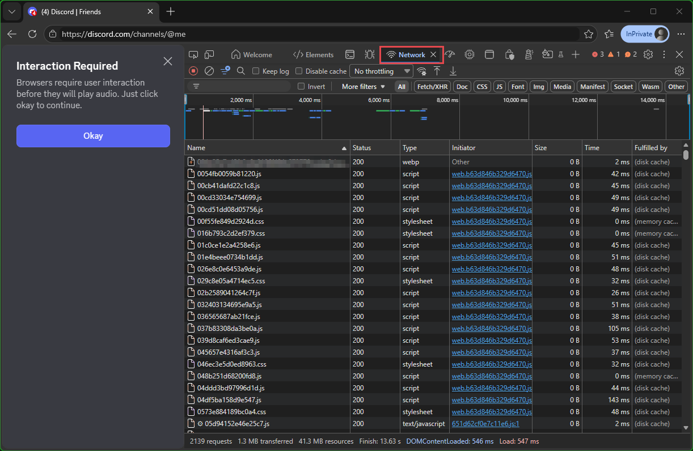
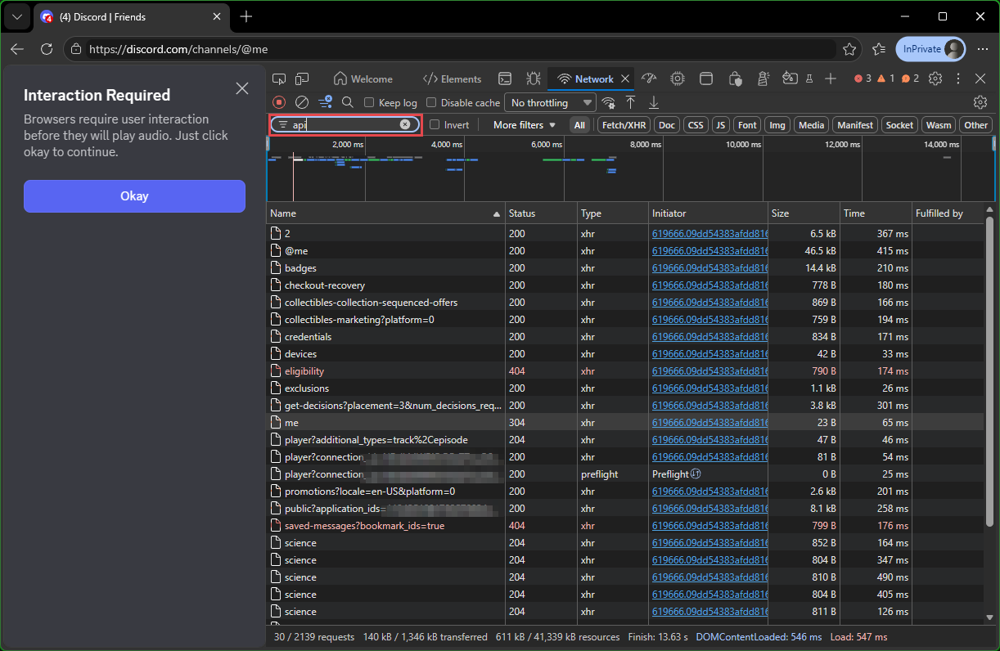
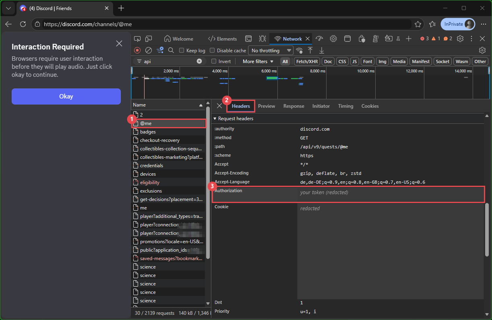
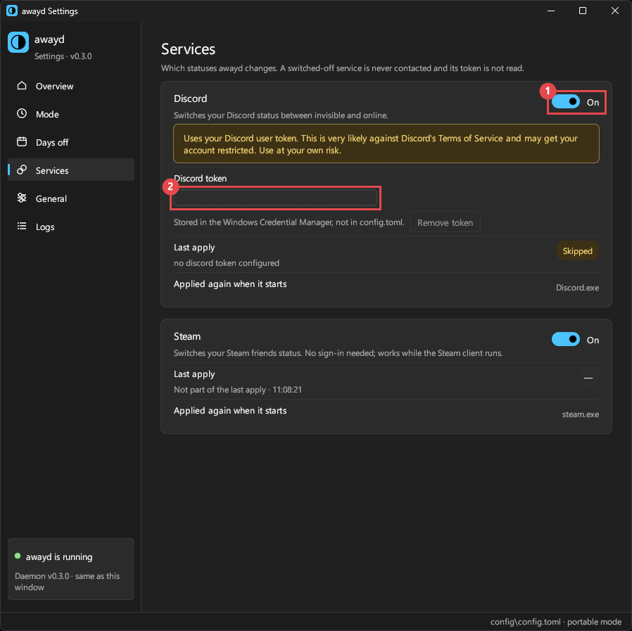

# Getting your Discord token

awayd switches your Discord status with your **Discord user token**. This guide shows how to
copy it from Discord in the browser and store it in awayd.

> [!WARNING]
> **Use at your own risk.** Automating a user account this way is very likely against Discord's
> Terms of Service and may get your account restricted or banned (see the
> [warning in the README](../README.md)). Anyone who has your token can act as your Discord
> account: treat it like a password, never paste it into websites, chats or scripts, and never
> run code someone sends you in the browser console to "get your token".

The steps use Microsoft Edge; Google Chrome looks and works the same. Discord changes its web
app from time to time, so names in the request list may differ slightly.

## 1. Open Discord in a private window

1. Open a private window: **Ctrl+Shift+N** (Edge InPrivate / Chrome Incognito). Extensions,
   bookmarks and other logins stay out of the way.
2. Go to <https://discord.com/app> and log in.
3. Press **F12** to open the developer tools and select the **Network** tab.

If the developer tools are not in English: gear icon (or F1) → **Preferences** → **Language**
→ English.

## 2. Show only Discord's API requests

The developer tools only record requests made while they are open, so the list is usually
empty at first.

1. Press **F5** to reload Discord while the developer tools stay open.
2. Type `api` into the filter field.
3. If the list is still empty, click around in Discord, for example open another channel or
   **Friends**: every action sends new requests.

## 3. Copy the `authorization` header

1. Click a request in the list, for example **`@me`** or **`science`**.
2. On the right, select the **Headers** tab (not Preview or Response, they show your account
   data).
3. Scroll to **Request Headers**. The value of **`authorization`** is your token. Select it and
   copy it (right click → Copy value, or select the text and press Ctrl+C).

If a request has no `authorization` row, pick another one from the list.

## 4. Store the token in awayd

1. Open the awayd settings (left click on the tray icon) → **Services**.
2. Switch **Discord** on (1).
3. Paste the token into **Discord token** (2) and press **Enter** (or leave the field).
   Quotes or spaces around the token are removed automatically.

The token is stored in the **Windows Credential Manager**, not in `config.toml` (details in
[SECURITY.md](../SECURITY.md)). awayd applies the status right away; **Last apply** on the same
page shows whether it worked.

## 5. Close the private window – do not log out

Close the private window without logging out. **Logging out ends this Discord session and
makes the token invalid.** The session stays in Discord under User Settings → **Devices**; it
belongs to awayd from now on.

## When the token stops working

**Last apply** shows a failure with `unauthorized (check token)`, the tray shows a warning, and
`awayctl.exe doctor --pretty` reports the problem. A token becomes invalid when

- you log out of the session it came from (also via User Settings → Devices),
- you change your Discord password,
- Discord ends the session for other reasons.

awayd does not retry a rejected token on its own. Get a new token as described above and paste
it into the field; it replaces the old one and awayd tries again right away.

## Removing the token

Click **Remove token** on the Services page, or switch Discord off: a switched-off service is
never contacted and its token is not read. To also end the session at Discord, log it out
under User Settings → **Devices**.
